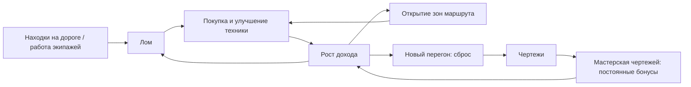

# 03. Геймдизайн-документ (GDD)

**Версия:** 2.0 · Числа — стартовые, финальные в `04_Economy_Balance.md`.

## 1. Обзор

Игрок — Капитан каравана. Экипажи и техника собирают лом в руинах, лом идёт на новую технику, караван едет через зоны к «Зелёному берегу». Раз за разом игрок начинает «Новый перегон» ради постоянных бонусов.

## 2. Основной цикл

| Масштаб | Что делает игрок |
|---------|------------------|
| 10 секунд | Тапает находки, купил единицу техники |
| 1 минута | Купил новый уровень техники или улучшение |
| 10 минут | Открыл тип техники/зону, закрыл просьбу |
| 1 час | Подошёл к первому «Новому перегону» |
| 1 день | 3–5 коротких сессий, офлайн-доход, ежедневный бонус |

## 3. Ресурсы

| Ресурс | Назначение | Источники | Тратится на |
|--------|-----------|-----------|-------------|
| **Лом** | Основная валюта | Экипажи, находки, события | Техника, улучшения, зоны |
| **Чертежи (ЧР)** | Валюта prestige | Новый перегон | Мастерская чертежей |
| **Жетоны** | Редкая мягкая валюта | Просьбы, достижения, ежедневный бонус | Косметика каравана, пропуск просьбы |

Реальные деньги и «валюта за деньги» в v1.0 отсутствуют.

## 4. Техника и экипажи (генераторы)

| Тир | Название | Зона |
|-----|----------|------|
| 1 | Ручная тележка | Руины города |
| 2 | Велосипед-сборщик | Руины города |
| 3 | Мотодрезина | Пыльная равнина |
| 4 | Вездеход-сборщик | Пыльная равнина |
| 5 | Рой дронов | Затопленное шоссе |
| 6 | Мобильная мастерская | Затопленное шоссе |
| 7 | Шагающий кран | Горный перевал |
| 8 | Передвижной завод | Горный перевал |

**Вехи:** при 10 / 25 / 50 / 100 / 200 / 300 / 400 / 500 единиц типа его доход ×2.
**Покупка:** ×1 / ×10 / ×100 / «макс.» (переключатель).

## 5. Улучшения (разовые)

| Группа | Эффект | Кол-во |
|--------|--------|--------|
| Тип техники | ×2…×5 доход одного типа | 16 |
| Общие | ×1.5…×3 весь доход | 8 |
| Находки | чаще появляются, сильнее тап | 6 |
| Стоянка (офлайн) | лимит и эффективность | 4 |

## 6. Активный слой

### 6.1. Находки
- На дороге и обочине вспыхивают находки (груда хлама, ящик, обломок) каждые 4–7 с, максимум 3 одновременно, мигают 8 с.
- Тап: лом = max(1, 10 с текущего дохода) × множитель находок.
- Серия из 5 подряд пойманных — «Золотая жила» (×2 награда с находок на 10 с).
- Пропуск находки не наказывается.

### 6.2. Грузовой дирижабль
- Пролетает по небу раз в 60–120 с, 6 с на экране.
- Тап: на выбор рандом — ×7 доход на 30 с, либо мгновенно 15 минут дохода, либо 3 жетона.
- RV-кнопка «Вызвать дирижабль» (кулдаун 3 мин): гарантированное появление.

## 7. Зоны маршрута

| Зона | Условие открытия | Содержит |
|------|------------------|----------|
| Руины города | Старт | Тир 1–2 |
| Пыльная равнина | Доход 10 тыс. лома/с; игрок нажимает «Перейти» | Тир 3–4 |
| Затопленное шоссе | Доход 10 млн лома/с; игрок нажимает «Перейти» | Тир 5–6 |
| Горный перевал | Доход 100 млрд лома/с; игрок нажимает «Перейти» | Тир 7–8 |

Доход заполняет шкалу маршрута к следующей зоне. При достижении порога шкала заполняется и появляется кнопка перехода; зона и её тиры активируются только после нажатия. Уже посещённые зоны можно выбрать и посетить повторно отдельным нажатием. Пороги управляются удалённой конфигурацией.

## 8. Prestige: «Новый перегон»

| Параметр | Значение |
|----------|----------|
| Доступность | Когда получаемых ЧР ≥ 5 (калибруется) |
| Сбрасывается | Лом, техника, улучшения, зоны |
| Сохраняется | ЧР, таланты, достижения, жетоны, косметика, радио-записи |
| Бонус | +2% дохода за каждый ЧР (аддитивно) + траты ЧР в Мастерской |
| Визуал | Смена погоды маршрута: пыль → туман → ливень → закат → снова |
| Подтверждение | Окно «получите X ЧР, бонус станет Y%» |

После подтверждения — логичная пауза для interstitial (см. `05`).

## 9. Мастерская чертежей (таланты за ЧР)

| Ветвь | Примеры талантов |
|-------|------------------|
| **Добыча** | +10% общий доход (до 5 ур.); тележка бесплатно в начале перегона |
| **Логистика** | Старт перегона с N единицами техники; скидка на технику −5% (до 5 ур.) |
| **Удача** | Дирижабль чаще; серия находок даёт больше |
| **Стоянка** | Лимит офлайна +2 ч; эффективность офлайна +10% |

Всего 12 талантов, формульная стоимость.

## 10. Просьбы попутчиков

- 3 слота. Просьба: «Принеси N лома» / «Купи K единиц тира T» / «Поймай M находок».
- Награда: жетоны + небольшой бонус лома.
- Обновление: новая просьба через 10 минут; можно «пропустить» за жетоны.
- Размер подстраивается под текущий доход (N = 20–40 мин дохода).
- Выдают Гвоздь (запчасти) и Тётя Роза (еда/провиант), реплики короткие.

## 11. Офлайн-доход («Пока караван стоял»)

- Накопление до лимита: 4 часа (база), +2 ч за талант (макс. 12 ч).
- Эффективность: 50% базово (до 80%).
- При входе окно с кнопками «Забрать» и «Забрать ×2 (реклама)».
- Время по серверному времени SDK, не по часам устройства (`06`).

## 12. Достижения (30)

Категории: Техника (8), Лом (6), Новый перегон (4), Находки (4), Просьбы (4), Дорога/время (4).
Награда — жетоны. Примеры: «Первая сотня» (100 единиц одного типа), «Колонна» (1000 единиц суммарно).

## 13. Ежедневный бонус («Тётя Роза»)

7 дней: лом (в минутах дохода), жетоны, дирижабль. Пропуск дня не сбрасывает цикл полностью (откат на 1 шаг). RV: «Забрать ×2».

## 14. Лидерборд

### v1.0
- Один лидерборд «Лучшие навигаторы»: суммарное количество Чертежей за всё время.
- Отправка результата и просмотр таблицы используют API лидербордов SDK; авторизация — только по желанию игрока.
- Значение для таблицы валидируется и не должно уменьшаться при обычном игровом прогрессе.

### После v1.0 — направление развития
- Добавить сезонные лиги/дивизионы с небольшими группами игроков и продвижением между уровнями (например, бронза → серебро → золото и выше). Цель — сделать высокие места достижимыми, а не только показывать недосягаемый глобальный топ.
- После проверки достаточного онлайна рассмотреть отдельные таблицы по зонам маршрута и периодические соревнования: недельные и месячные, с разными понятными показателями. Дневные таблицы — только если они дают ценность без чрезмерного дробления игроков.
- Не запускать одновременно много пересекающихся таблиц: сначала проверить активную аудиторию, правила сброса сезона, античит и ограничения SDK; затем выбрать минимальный набор по данным.

## 15. Сохранение прогресса

- Прогресс автоматически сохраняется локально и восстанавливается после закрытия/перезагрузки игры.
- При желании игрока прогресс синхронизируется с облаком через Яндекс ID; играть и сохраняться локально можно без авторизации.
- При входе с нескольких устройств разрешение конфликта облачной и локальной копий должно быть понятным и не приводить к тихой потере более свежего прогресса (см. `06`).

## 16. Нарратив

### 16.1. Радио-журнал
- Вкладка «Радио» в «Наградах». Записи открываются: при входе в зону (3–4 на зону) и за каждый Новый перегон (по одной).
- ~16 записей к v1.0, каждая 1–3 строки.
- Формат: «Помехи… Зелёный берег… там тепло…» + короткий комментарий Искры.

### 16.2. Тон реплик
Короткие, тёплые, с юмором. Без слов о войне, власти, вере, без описаний насилия.

### 16.3. Пролог
3 кадра-иллюстрации с подписями (пропускаемые): 1) пустая дорога и пыль; 2) караван заводит двигатели; 3) рация ловит сигнал.

### 16.4. Список строк для локализации
Хранятся ключами: `radio.zone1.01`, `npc.gvozd.order.01`, `iskra.tip.03` и т. д. (RU/EN).

## 17. Обучение (FTUE) — первые 5 минут

| Время | Событие | Подсказка (Искра) |
|-------|---------|-------------------|
| 0:00 | Экран загрузки → Game Ready | — |
| 0:05 | На дороге вспыхнула находка, лома 0 | «Коснись находки!» |
| 0:15 | Первый тап → +1 лом | — |
| 0:30 | Лома ≥ 10 → подсвечена «Ручная тележка» | «Возьмём тележку» |
| 1:00 | Первая тележка собирает сама | «Теперь она работает без нас» |
| 2:00 | Открыт Тир 2; появляется просьба Гвоздя | «Гвоздь просит запчасти» |
| 3:00 | Просьба выполнена → жетоны | «Жетоны пригодятся» |
| 4:00 | Первая веха ×2 | Мини-анимация |
| 5:00 | Подсказка про офлайн | «Можно закрыть — караван не встанет» |

Правила: не более 2 строк, закрывается тапом, не блокирует экран дольше 3 с, пропускаемо.

## 18. Интерфейс

| Экран | Содержимое |
|-------|-----------|
| Главный | Верхняя панель (лом, доход/с, ЧР), дорога с караваном, нижние вкладки |
| Техника | Список с количеством, ценой, переключатель ×1/×10/×100/макс. |
| Улучшения | Сетка доступных улучшений |
| Просьбы | 3 карточки |
| Мастерская | Таланты (после первого перегона) |
| Награды | Достижения, радио, ежедневный бонус, косметика |
| Лидерборд | «Лучшие навигаторы» — суммарные Чертежи за всё время |
| Настройки | Звук, язык, вход по Яндекс ID, политика (текстом), версия |
| Окна | Офлайн, ежедневный бонус, prestige, RV-предложения |

Одна рука, нижние вкладки, длинные списки — с собственной прокруткой внутри панели.

### Управление
- **Мобильные:** касания; долгое нажатие без контекстного меню (1.6.1.8).
- **Десктоп:** мышь по умолчанию; горячие клавиши по `event.code` (не зависят от раскладки): Space — ближайшая находка, 1–4 — вкладки.

## 19. Звук
Музыка и эффекты раздельно; кнопка отключения звука на главном экране (6.2). Пауза звука при сворачивании и во время рекламы (1.3, 4.7).

## 20. Локализация (RU / EN)
JSON-ключи (`ui.buy`, `crew.t1.name`). Числа — сокращения (K, M, B, T, aa, ab…). Название игры идентично во всех материалах черновика (5.1.3).

## 21. Косметика за жетоны

- В v1.0 доступно 6 косметических предметов за жетоны, например раскраски «Маяка» и гирлянды.
- Ассортимент можно расширять в будущих версиях сезонными и праздничными предметами.

## 22. Решения по будущим версиям

- Режим «ночь» — после v1.0.
- ТВ-режим (1.6.3) — после v1.2.
